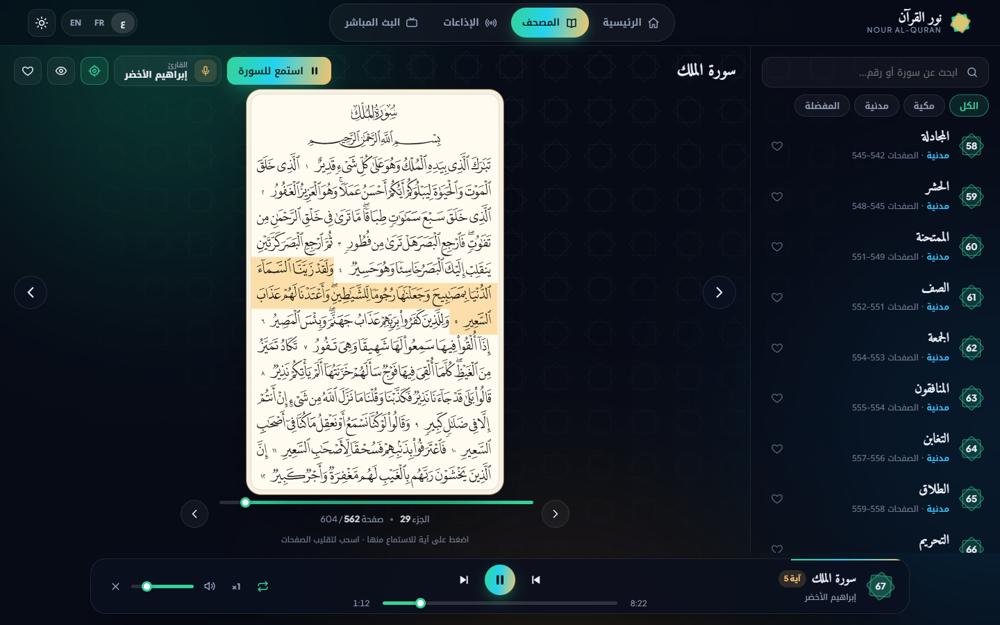
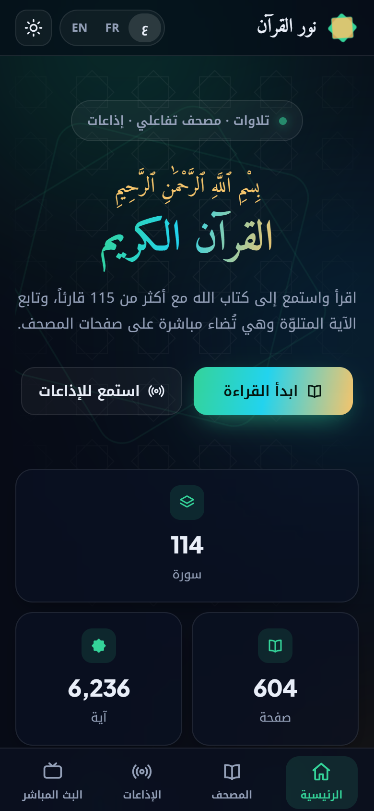
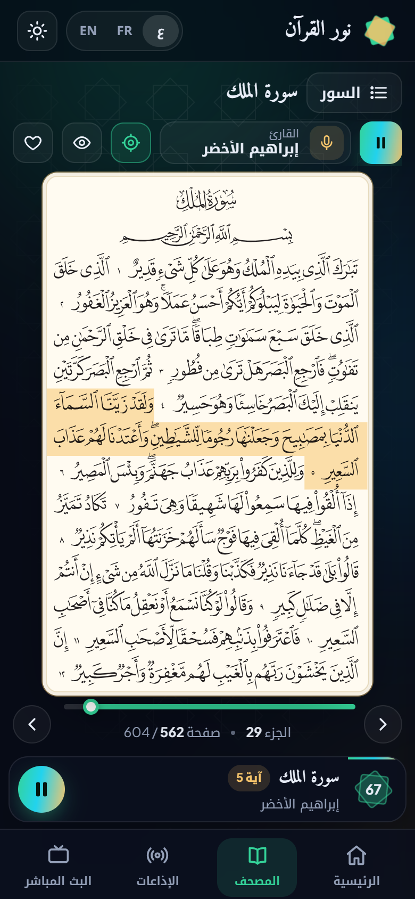
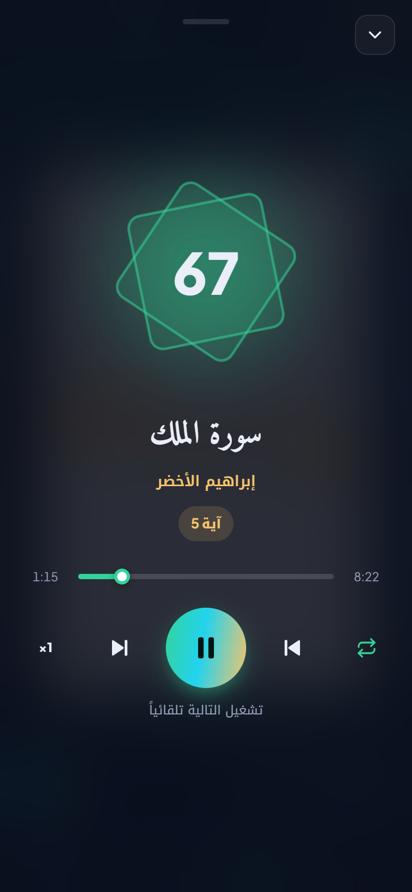

# Nour Al-Quran

Lisez et écoutez le Coran en ligne : un mushaf interactif où le verset récité s'illumine sur la page, plus d'une centaine de récitateurs, des radios coraniques et le direct de La Mecque et de Médine.

**Démo : https://ilyasoulmidi.github.io/quran-reader-app/**

<p align="center">
  
  
</p>

<p align="center">
  
  
  
</p>

## Fonctionnalités

- **Mushaf interactif** : les 604 pages. Le verset en cours est surligné et la page tourne toute seule. Touchez un verset pour écouter à partir de lui.
- **Plus de 100 récitateurs**, avec recherche.
- **Lecteur audio** qui continue entre les pages, avec vitesse, répétition et lecture enchaînée. Il se contrôle depuis l'écran de verrouillage du téléphone.
- **Radios coraniques** (plus de 170), avec recherche et favoris.
- **Direct** : chaîne du Coran (La Mecque) et chaîne de la Sunna (Médine).
- **Arabe, français, anglais** et **thème sombre ou clair**.
- **Adaptée au téléphone** : navigation en bas, liste des sourates en tiroir, lecteur plein écran.

## Technologies

React 18 · Redux Toolkit · React Router · Framer Motion · AOS · Vite · API [mp3quran.net](https://mp3quran.net/api)

## Lancer le projet

```bash
npm install
npm run dev
```

Déploiement sur GitHub Pages : `npm run deploy`
