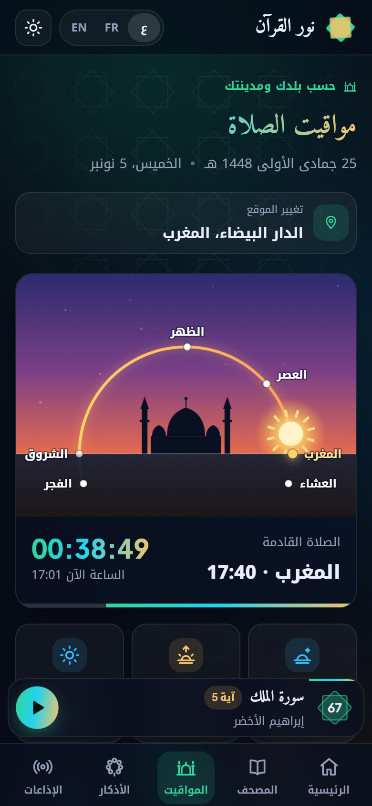

# Nour Al-Quran

Lisez et écoutez le Coran en ligne : un mushaf interactif où le verset récité s'illumine sur la page, les horaires de prière de votre ville, les adhkar du matin et du soir, des radios coraniques et le direct de La Mecque et de Médine.

**Démo : https://ilyasoulmidi.github.io/quran-reader-app/**

<p align="center">
  
  
</p>

<p align="center">
  
  
  
  
</p>

## Fonctionnalités

- **Mushaf interactif** : les 604 pages. Le verset en cours est surligné et la page tourne toute seule. Touchez un verset pour écouter à partir de lui.
- **Plus de 100 récitateurs**, avec recherche.
- **Horaires de prière** selon le pays et la ville (ou votre position), avec la méthode de calcul officielle du pays, un compte à rebours et un ciel animé où le soleil suit sa course du Fajr à l'Isha.
- **Adhkar du matin et du soir** (Hisn al-Muslim), avec un compteur pour chaque dhikr et la progression gardée pour la journée.
- **Lecteur audio** qui continue entre les pages, avec vitesse, répétition et lecture enchaînée. Il se contrôle depuis l'écran de verrouillage du téléphone.
- **Radios coraniques** (plus de 170) avec recherche et favoris, et **direct** de La Mecque et de Médine.
- **Arabe, français, anglais** et **thème sombre ou clair**.
- **Adaptée au téléphone** : navigation en bas, liste des sourates en tiroir, lecteur plein écran.

## Technologies

React 18 · Redux Toolkit · React Router · Framer Motion · AOS · Vite · API [mp3quran.net](https://mp3quran.net/api) · API [Aladhan](https://aladhan.com/prayer-times-api)

## Lancer le projet

```bash
npm install
npm run dev
```

Déploiement sur GitHub Pages : `npm run deploy`
